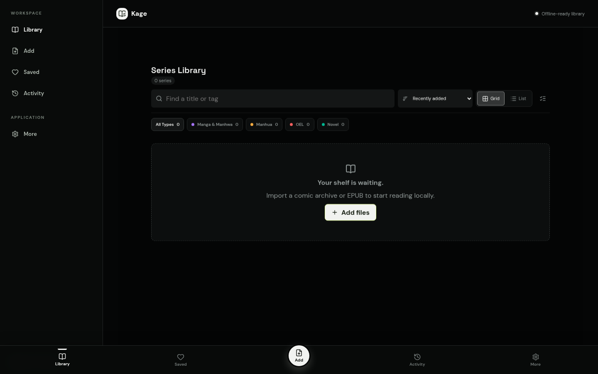
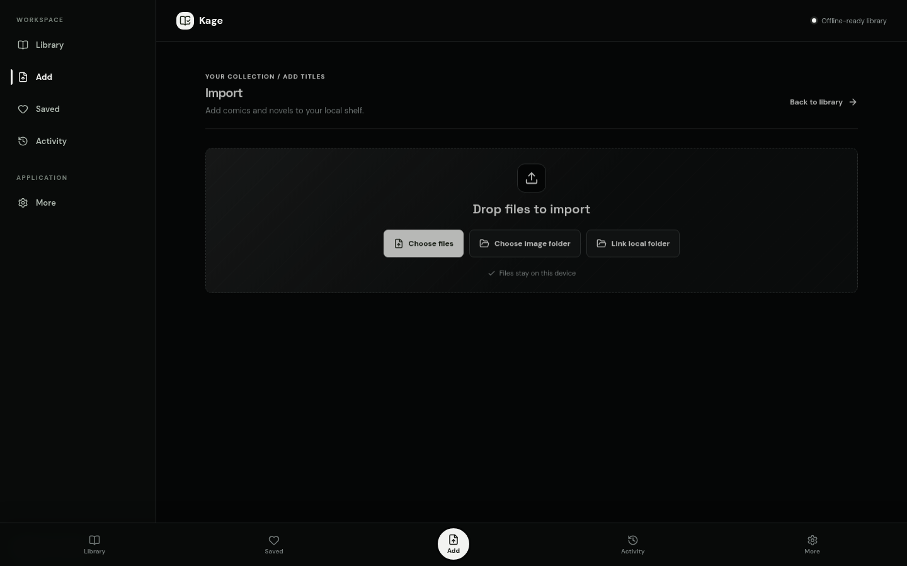
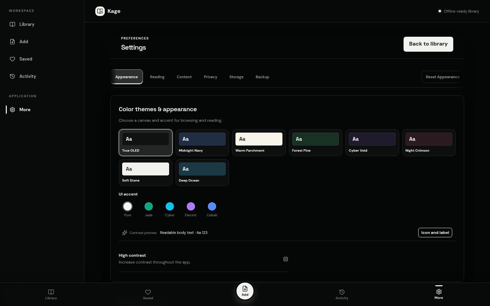

# Kage Reader

A privacy-first, offline-ready comic, manga, manhwa, and EPUB reader for the browser.

Kage keeps your library on your device, gives you a focused reading experience, and makes importing, organizing, backing up, and cleaning up local content straightforward.

## Screenshots

### Library



### Import



### Settings and themes



## Features

- Local-first library powered by IndexedDB and browser storage.
- Import comic archives, image folders, EPUB files, and linked local folders.
- Library views for all titles, favorites, queue, history, continue reading, and recently added content.
- Search, sorting, filters, grid/list layouts, tags, notes, and chapter selection.
- Reader modes for manga, webtoon, single page, spreads, and continuous reading.
- Reading progress restoration, bookmarks, annotations, page search, zoom, fullscreen, and keyboard controls.
- Import progress with pause, resume, cancel, retry, and clear completion feedback.
- Backup and restore for local library data, plus series export.
- Per-series page-cache removal while preserving metadata and reading progress.
- Accessible destructive-action dialogs, Undo feedback, semantic status badges, reduced-motion support, and responsive navigation.
- Theme and accent controls with high-contrast support.
- Installable PWA with offline-ready behavior.

## Privacy

Kage is designed to work locally. Imported books, reading progress, bookmarks, notes, and preferences are stored in the browser on your device. No account or hosted content service is required for the core reading experience.

## Getting started

### Requirements

- Node.js 20 or newer
- npm

### Install

```bash
npm install
```

### Start the development server

```bash
npm run dev
```

Open the local URL shown by Vite in your browser.

### Build for production

```bash
npm run build
```

### Preview a production build

```bash
npm run preview
```

### Run tests and lint

```bash
npm run test -- --run
npm run lint
```

## Project structure

```text
src/
  components/       React UI and route-level screens
  lib/import/       Archive, EPUB, folder, and import workflows
  lib/reader/       Reader modes, search, and reading behavior
  lib/storage/      IndexedDB, backups, exports, and cache management
  lib/preferences/  Theme and reader preferences
  styles/           Design tokens and application styles
public/             PWA assets and README screenshots
```

## Supported content

Kage is intended for common comic and ebook workflows, including comic archives, manga/manhwa image folders, and EPUB books. Browser support for linked folders and some file-system features depends on the browser and its permissions.

## License

This project is currently distributed without a public license. Add a license before accepting external contributions or redistributing the project.
